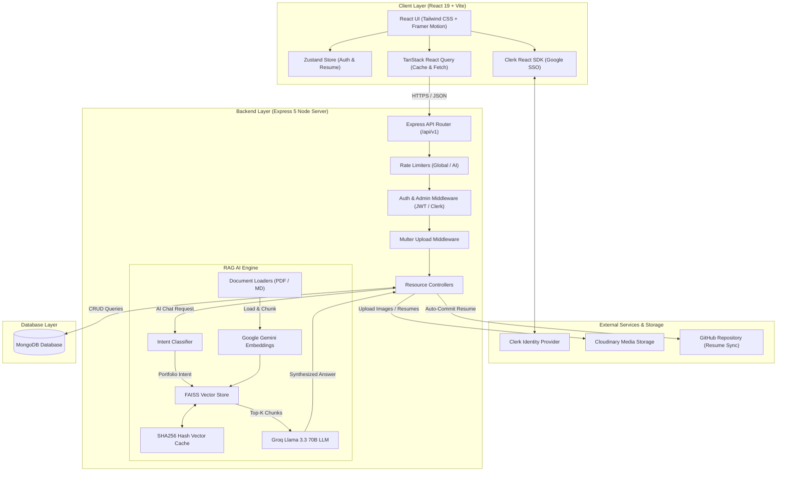
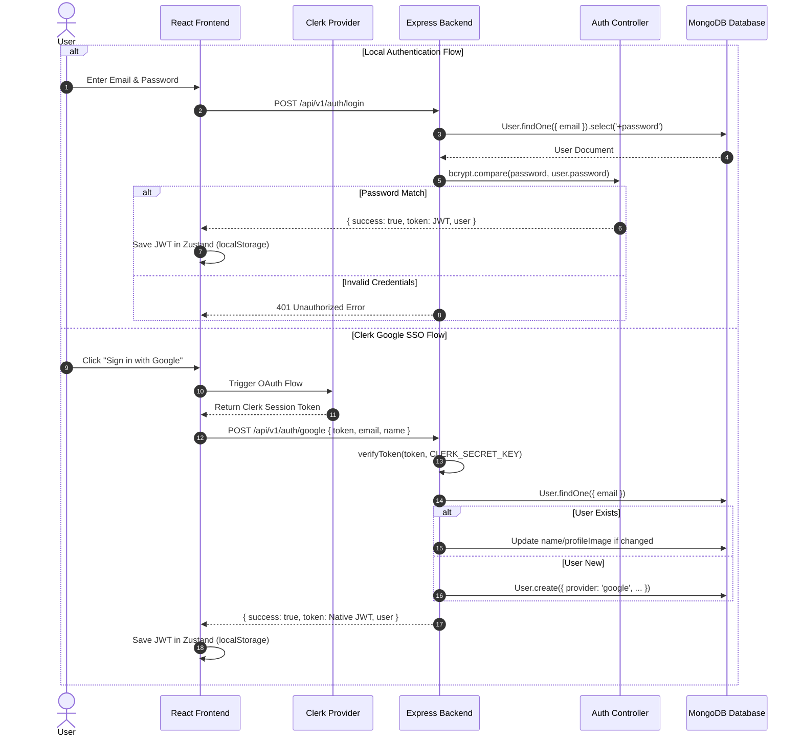
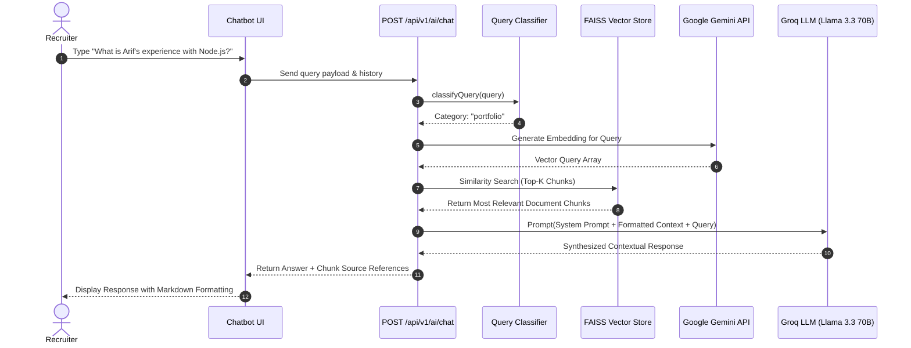

# 🚀 Full-Stack AI-Powered Developer Portfolio & Admin CMS

> A production-grade, enterprise-ready full-stack developer portfolio and content management system (CMS) integrated with a Retrieval-Augmented Generation (RAG) AI assistant, Clerk OAuth, Cloudinary document management, real-time analytics, and dynamic administrative control.

---

## 📋 Table of Contents

- [Overview & Purpose](#-overview--purpose)
- [Problem Statement](#-problem-statement)
- [Features](#-features)
  - [Implemented Features](#implemented-features)
  - [In-Progress Features](#in-progress-features)
  - [Planned Features](#planned-features)
- [Tech Stack](#-tech-stack)
- [System Architecture](#-system-architecture)
- [High-Level Workflow](#-high-level-workflow)
- [Authentication Flow](#-authentication-flow)
- [RAG AI Architecture & Chatbot Workflow](#-rag-ai-architecture--chatbot-workflow)
- [Database Schema & Models](#-database-schema--models)
- [Entity-Relationship (ER) Diagram](#-entity-relationship-er-diagram)
- [API Documentation](#-api-documentation)
- [Environment Variables](#-environment-variables)
- [Third-Party Services](#-third-party-services)
- [Frontend Architecture](#-frontend-architecture)
  - [State Management](#state-management)
  - [Routing Structure](#routing-structure)
  - [Component Hierarchy](#component-hierarchy)
- [Backend Architecture](#-backend-architecture)
- [Complete Directory & File Structure](#-complete-directory--file-structure)
- [Deployment Architecture](#-deployment-architecture)
- [Security Considerations](#-security-considerations)
- [Error Handling Strategy](#-error-handling-strategy)
- [Performance Optimizations](#-performance-optimizations)
- [Future Roadmap](#-future-roadmap)
- [Known Limitations](#-known-limitations)
- [Setup & Installation](#-setup--installation)
- [Development Workflow](#-development-workflow)
- [Screenshots & Visual Demos](#-screenshots--visual-demos)
- [Contribution Guidelines](#-contribution-guidelines)
- [License](#-license)

---

## 🎯 Overview & Purpose

The **Full-Stack AI-Powered Developer Portfolio** is designed to bridge the gap between static personal websites and interactive, intelligence-driven portfolio platforms. 

Built using a modern decoupled architecture (React 19 + Express 5 + MongoDB), the project serves two main audiences:
1. **Visitors & Recruiters**: Provides an immersive, high-performance experience to explore projects, technical skills, verified certificates, career history, interactive mini-games, and ask questions to a real-time **RAG AI Assistant** that synthesizes responses directly from parsed resume documents and custom knowledge bases.
2. **Administrators**: Offers a protected, data-rich Dashboard for real-time traffic monitoring, granular content management (projects, skills, certificates, resumes, experiences), user role governance, and resume file synchronization to Cloudinary and GitHub repositories.

---

## 🧩 Problem Statement

Traditional developer portfolios suffer from several key drawbacks:
- **Static Content & Maintenance Overhead**: Updating projects or resumes requires manual code changes, rebuilds, and redeployments.
- **Passive Recruiter Experience**: Visitors must manually read lengthy PDFs or scan bullet points, often missing relevant qualifications.
- **Lack of Verification & Analytics**: Developers have no visibility into recruiter engagement, page traffic, or chatbot interactions.
- **Insecure or Fragmented Auth**: Implementing ad-hoc authentication leads to compromised security, fragmented user identities, and poor login persistence.

**This Solution Resolves These Pain Points By:**
- Implementing a full-blown **Admin CMS** with live file uploads (Cloudinary) and dynamic MongoDB document management.
- Deploying an in-context **RAG AI Chatbot** powered by FAISS vector search, Google Gemini embeddings, and Groq Llama 3.3 70B LLM to answer recruiter queries instantly.
- Providing an **Hybrid Auth System** supporting native Bcrypt password authentication alongside Clerk OAuth / Google SSO.
- Collecting privacy-respecting **Analytics** to visualize visitor traffic, chatbot usage, and project view trends.

---

## ✨ Features

### Implemented Features

#### 🌐 Public Portfolio
- **Hero & Interactive Intro**: Dynamic title animations, quick action call-to-actions, and social links.
- **Filterable Projects Section**: Category-based filtering (MERN, Django, AI), live demo links, repository buttons, and view counters.
- **Interactive Experience Timeline**: Chronological presentation of professional roles, responsibilities, and dates.
- **Skills Matrix**: Categorized tech stack representation with proficiency percentages, logos, and ordering control.
- **Certificates Showcase**: Visual display of credentials with issuer details and image lightboxes.
- **Interactive Mini-Games**: Built-in games section for user engagement.
- **RAG AI Assistant**: Global floating and dedicated section chatbot with intent classification (Greetings, General Programming, Portfolio-Specific Q&A).
- **Dynamic Resume Downloader**: System automatically fetches, caches, and serves the active default resume version.
- **Contact Form**: Secure message submission with IP tracking and server-side rate limiting.

#### 🛡️ Admin Dashboard & CMS
- **Real-Time Analytics Dashboard**: Visual graphs (Chart.js) detailing daily, monthly, and yearly page views, project clicks, chatbot interactions, and top-viewed pages.
- **Project Manager**: Complete CRUD operations with image file upload via Multer & Cloudinary.
- **Skill Manager**: Add/edit/delete skills, manage display order, percentage sliders, and logos.
- **Experience Manager**: Manage career history entries with start/end date validation and current employment toggles.
- **Certificate Manager**: Upload and organize certificates with issuing authority details.
- **Resume Manager**: Upload multiple resume versions (PDF/DOCX), parse text into RAG vector knowledge base, set default active version, and trigger GitHub repository syncing.
- **User Management**: View registered users, inspect sign-in providers (Local vs Google SSO), and promote/demote administrative roles.

### In-Progress Features
- **RAG Streaming Responses**: Upgrading LLM responses from single-payload JSON to chunked SSE streams for lower perceived latency.
- **Multi-Tenant Portfolio Customization**: Enabling theme customization (color tokens, font presets) directly from the Admin panel.

### Planned Features
- **Recruiter AI Interview Simulator**: Interactive mock interview mode based on candidate's uploaded resume chunks.
- **Automated GitHub Activity Sync**: Background cron job to pull live commit activity and repository stats directly into the Projects section.

---

## 🛠️ Tech Stack

### Frontend Architecture
| Layer | Technology | Purpose |
| :--- | :--- | :--- |
| **Framework** | React 19 (`react`, `react-dom`) | Core UI library using functional components & hooks |
| **Build Tool** | Vite 8 | Ultra-fast HMR and bundle optimization |
| **Styling** | Tailwind CSS v4 (`@tailwindcss/vite`) | Utility-first responsive styling engine |
| **Animations** | Framer Motion (`framer-motion`) | Micro-interactions, page transitions, and modal animations |
| **Routing** | React Router DOM v7 (`react-router-dom`) | Client-side routing, protected routes, and layout wrappers |
| **State Management** | Zustand v5 (`zustand`) | Lightweight store for auth session & resume state |
| **Data Fetching** | TanStack React Query v5 (`@tanstack/react-query`) | Server state caching, optimistic updates, and automatic refetching |
| **Form Management** | React Hook Form & Zod | Type-safe form validation (`@hookform/resolvers`, `zod`) |
| **Auth Provider** | `@clerk/clerk-react` | Google SSO & OAuth token generation |
| **Charts** | Chart.js & `react-chartjs-2` | Admin dashboard analytical charts |

### Backend Architecture
| Layer | Technology | Purpose |
| :--- | :--- | :--- |
| **Runtime** | Node.js (ES Modules) | Asynchronous backend execution environment |
| **Framework** | Express 5 (`express`) | Modular HTTP routing, middleware pipeline, and error handling |
| **Database** | MongoDB & Mongoose 9 (`mongoose`) | NoSQL document store with strict schema validation |
| **Auth & Security** | JWT (`jsonwebtoken`), Bcrypt.js, `@clerk/clerk-sdk-node` | Session token verification and password hashing |
| **Rate Limiting** | `express-rate-limit` | IP-based request throttle for sensitive API endpoints |
| **File Storage** | Multer & Cloudinary SDK (`cloudinary`) | Multipart upload buffer processing & cloud media hosting |
| **Document Parsers** | `pdf-parse`, `mammoth` | Extraction of raw text from PDF & DOCX resume files |

### RAG & AI Subsystem
| Component | Technology | Description |
| :--- | :--- | :--- |
| **LLM Provider** | Groq API (`groq-sdk`, `@langchain/groq`) | Powers ultra-fast inference using `llama-3.3-70b-versatile` |
| **Embeddings** | Google Gemini (`@langchain/google-genai`) | Generates vector embeddings via `text-embedding-004` |
| **Vector Store** | FAISS Node (`faiss-node`) | High-performance in-memory vector index for similarity search |
| **Orchestration** | LangChain (`@langchain/core`, `@langchain/community`) | Context retrieval, prompt engineering, and chain execution |
| **Cache Layer** | SHA-256 Hash File Cache | Avoids redundant API calls by caching vector store index on disk |

---

## 🏗️ System Architecture

The following diagram illustrates the complete system architecture, showing interactions between the client browser, API server, database, cloud services, and AI RAG engine:



---

## 🔄 High-Level Workflow

1. **Visitor Navigation**: The user visits the portfolio. React Query fetches public projects, skills, certificates, and experience timelines from `/api/v1/*` endpoints.
2. **Analytics Dispatch**: Upon page mount, `usePageTracking` dispatches an asynchronous `POST /api/v1/analytics/visit` payload to log views in MongoDB without blocking UI rendering.
3. **Resume Request**: When a user clicks "Download Resume", `useDefaultResumeStore` requests `/api/v1/resume/default`. The server responds with the Cloudinary URL or serves the binary buffer directly.
4. **Chatbot Interaction**: 
   - Visitor inputs a query in `GlobalChatbot`.
   - Request hits `POST /api/v1/ai/chat` (throttled by `aiRateLimiter`).
   - RAG subsystem classifies query intent.
   - If portfolio-related, relevant document chunks are retrieved from FAISS, wrapped with system prompts, and passed to Groq Llama-3.3-70B.
5. **Admin Operations**: An authorized admin logs into `/login` or via Google SSO, accessing `/admin/*`. The admin can create projects, update career milestones, or upload a new resume file.

---

## 🔐 Authentication Flow

The system supports a dual authentication architecture:
1. **Local Authentication**: Classic email/password register and login utilizing `bcryptjs` for salt rounds and custom signed JWT tokens (`JWT_SECRET`).
2. **Google OAuth via Clerk**: Front-end handles Google SSO using `@clerk/clerk-react`. Upon token issuance, the client invokes `POST /api/v1/auth/google` or `/sync-user`. The backend verifies the token using `@clerk/clerk-sdk-node`, creates or updates the MongoDB `User` document, and issues a native backend JWT.



---

## 🧠 RAG AI Architecture & Chatbot Workflow

The AI assistant utilizes a state-of-the-art Retrieval-Augmented Generation pipeline:

1. **Document Loading**: Upon server start or resume upload, documents (`knowledge.md` and active `resume.pdf`) are loaded via `mammoth` / `pdf-parse` and split into text chunks using `@langchain/textsplitters`.
2. **Embedding & Indexing**: Text chunks are converted to 768-dimensional vector embeddings using Google Gemini (`text-embedding-004`) and stored in a local `FAISS` vector store.
3. **SHA-256 Hash Caching**: To prevent unnecessary embedding calls during server restarts, a SHA-256 hash of the source files is calculated. If the hash matches the cached index file in `server/src/rag/data/cache`, the FAISS store is restored instantly from disk.
4. **Query Classification**: Incoming queries are categorized by `classifyQuery.js`:
   - `greeting`: Simple friendly responses without vector search.
   - `general`: Technical/educational questions answered via LLM standard knowledge base.
   - `portfolio`: Candidate/resume queries answered via vector similarity search + RAG prompt context.



---

## 🗄️ Database Schema & Models

### 1. `User` Schema
- `name`: `String` (Required)
- `email`: `String` (Required, Unique, Lowercase)
- `password`: `String` (Required for `provider === 'local'`, Hidden by default)
- `role`: `Enum ['user', 'admin']` (Default: `'user'`)
- `provider`: `Enum ['local', 'google']` (Default: `'local'`)
- `profileImage`: `String`
- `timestamps`: `true`

### 2. `Project` Schema
- `title`: `String` (Required, Max 120 chars)
- `description`: `String` (Required, Max 2000 chars)
- `tags`: `[String]`
- `category`: `Enum ['MERN', 'Django', 'AI']` (Required, Indexed)
- `image`: `String` (Cloudinary URL)
- `github`: `String`
- `live`: `String`
- `date`: `String`
- `projectDate`: `Date` (Indexed)
- `views`: `Number` (Default: `0`)
- `timestamps`: `true`

### 3. `Skill` Schema
- `skill`: `String` (Required, Unique)
- `percentage`: `Number` (0 - 100)
- `category`: `String`
- `logo`: `String` (Cloudinary image URL)
- `displayOrder`: `Number` (Default: `0`)
- `featured`: `Boolean` (Default: `true`)
- `isActive`: `Boolean` (Default: `true`)
- `timestamps`: `true`

### 4. `Experience` Schema
- `company`: `String` (Required)
- `role`: `String` (Required)
- `duration`: `String`
- `startDate`: `Date` (Required, Indexed)
- `endDate`: `Date` (Nullable if currently working)
- `isCurrentlyWorking`: `Boolean` (Default: `false`)
- `description`: `String` (Required)
- `timestamps`: `true`

### 5. `Certificate` Schema
- `title`: `String` (Required)
- `image`: `String` (Required, Cloudinary URL)
- `organization`: `String` (Required, normalized with issuer)
- `issuer`: `String`
- `issuedDate`: `Date` (Indexed)
- `timestamps`: `true`

### 6. `Resume` Schema
- `title`: `String` (Required)
- `category`: `Enum ['fullstack', 'backend', 'frontend', 'python', 'ai']` (Required)
- `fileUrl`: `String` (Required, Cloudinary URL)
- `fileName`: `String`
- `storageProvider`: `Enum ['cloudinary']` (Default: `'cloudinary'`)
- `isDefault`: `Boolean` (Default: `false`, Indexed)
- `timestamps`: `true`

### 7. `ResumeKnowledge` Schema
- `sourceName`: `String` (Default: `'resume'`)
- `rawText`: `String`
- `chunks`: `[{ index: Number, text: String, tokens: [String] }]`
- `timestamps`: `true`

### 8. `Message` Schema
- `name`: `String` (Required)
- `email`: `String` (Required)
- `message`: `String` (Required)
- `ipAddress`: `String`
- `timestamps`: `true`

### 9. `Analytics` Schema
- `page`: `String` (Required)
- `date`: `Date` (Required)
- `views`: `Number`
- `clicks`: `Number`
- `chatbotUsage`: `Number`
- `gameUsage`: `Number`
- `projectViews`: `Number`
- `lastEventAt`: `Date`
- `lastEventMeta`: `Mixed`
- `timestamps`: `true` (Unique Index on `{ page: 1, date: 1 }`)

---

## 📊 Entity-Relationship (ER) Diagram

```mermaid
erDiagram
    USER {
        ObjectId _id PK
        string name
        string email UK
        string password
        string role "user | admin"
        string provider "local | google"
        string profileImage
        date createdAt
        date updatedAt
    }

    PROJECT {
        ObjectId _id PK
        string title
        string description
        string_array tags
        string category "MERN | Django | AI"
        string image
        string github
        string live
        date projectDate
        number views
        date createdAt
    }

    SKILL {
        ObjectId _id PK
        string skill UK
        number percentage
        string category
        string logo
        number displayOrder
        boolean featured
        boolean isActive
    }

    EXPERIENCE {
        ObjectId _id PK
        string company
        string role
        string duration
        date startDate
        date endDate
        boolean isCurrentlyWorking
        string description
    }

    CERTIFICATE {
        ObjectId _id PK
        string title
        string image
        string organization
        string issuer
        date issuedDate
    }

    RESUME {
        ObjectId _id PK
        string title
        string category
        string fileUrl
        string fileName
        boolean isDefault
    }

    RESUMEKNOWLEDGE {
        ObjectId _id PK
        string sourceName
        string rawText
        array chunks
    }

    MESSAGE {
        ObjectId _id PK
        string name
        string email
        string message
        string ipAddress
        date createdAt
    }

    ANALYTICS {
        ObjectId _id PK
        string page
        date date
        number views
        number clicks
        number chatbotUsage
        number gameUsage
        number projectViews
        date lastEventAt
    }
```



---

## 📡 API Documentation

### Public Endpoints

| Method | Endpoint | Description | Auth Required |
| :--- | :--- | :--- | :--- |
| `GET` | `/api/v1/health` | Service healthcheck & server uptime | No |
| `POST` | `/api/v1/auth/register` | Register new user account | No |
| `POST` | `/api/v1/auth/login` | Authenticate with local email/password | No |
| `POST` | `/api/v1/auth/google` | Sign in / register via Clerk Google OAuth | No |
| `POST` | `/api/v1/auth/sync-user` | Sync backend user record with Clerk session | No |
| `GET` | `/api/v1/projects` | List projects (supports category filter & pagination) | No |
| `GET` | `/api/v1/projects/:id` | Get project details by ID | No |
| `POST` | `/api/v1/projects/:id/view` | Increment project view counter | No |
| `GET` | `/api/v1/skills` | List active skills sorted by display order | No |
| `GET` | `/api/v1/certificates` | List verified certificates | No |
| `POST` | `/api/v1/contact` | Submit contact form message | No |
| `GET` | `/api/v1/resume` | Retrieve active resume metadata | No |
| `GET` | `/api/v1/resume/default` | Get default active resume link | No |
| `GET` | `/api/v1/download-resume` | Directly stream or redirect to default resume PDF | No |
| `GET` | `/api/v1/ai/status` | Check RAG system initialization status | No |
| `POST` | `/api/v1/ai/chat` | Query RAG Chatbot (Rate-limited) | No |
| `GET` | `/api/v1/games` | List interactive games metadata | No |
| `POST` | `/api/v1/analytics/visit` | Log page visit | No |
| `POST` | `/api/v1/analytics/event` | Log custom interaction event | No |

---

### Admin Endpoints (Requires `Bearer Token` + `role === 'admin'`)

| Method | Endpoint | Description |
| :--- | :--- | :--- |
| `POST` | `/api/v1/projects` | Create new project (Multipart file upload supported) |
| `PATCH` | `/api/v1/projects/:id` | Update project by ID |
| `DELETE` | `/api/v1/projects/:id` | Delete project by ID |
| `GET` | `/api/v1/skills/all` | List all skills including inactive entries |
| `POST` | `/api/v1/skills` | Create skill with optional logo upload |
| `PATCH` | `/api/v1/skills/:id` | Update skill parameters |
| `DELETE` | `/api/v1/skills/:id` | Delete skill entry |
| `POST` | `/api/v1/certificates` | Create certificate entry with image upload |
| `PATCH` | `/api/v1/certificates/:id` | Update certificate details |
| `DELETE` | `/api/v1/certificates/:id` | Delete certificate |
| `GET` | `/api/v1/admin/experiences` | List all career experiences |
| `POST` | `/api/v1/admin/experiences` | Create new career milestone |
| `PATCH` | `/api/v1/admin/experiences/:id` | Update experience entry |
| `DELETE` | `/api/v1/admin/experiences/:id` | Delete experience entry |
| `GET` | `/api/v1/admin/resumes` | List all uploaded resumes |
| `POST` | `/api/v1/admin/resumes` | Upload new resume (Triggers Cloudinary, RAG parsing & GitHub sync) |
| `PATCH` | `/api/v1/resume/set-default/:id` | Set specified resume ID as active default |
| `DELETE` | `/api/v1/admin/resumes/:id` | Delete resume from storage and database |
| `GET` | `/api/v1/admin/users` | List registered system users |
| `PATCH` | `/api/v1/admin/users/:id/role` | Promote/Demote user role (`user` / `admin`) |
| `DELETE` | `/api/v1/admin/users/:id` | Remove user account |
| `GET` | `/api/v1/contact` | Read submitted contact messages |
| `GET` | `/api/v1/analytics/summary` | Get aggregated analytics metrics |
| `GET` | `/api/v1/analytics/daily` | Get daily breakdown chart data |
| `GET` | `/api/v1/analytics/monthly` | Get monthly analytics summary |
| `GET` | `/api/v1/analytics/yearly` | Get yearly analytics summary |

---

### Request & Response Payload Examples

#### 1. AI Chat Request (`POST /api/v1/ai/chat`)
**Request Header**: `Content-Type: application/json`  
**Body**:
```json
{
  "message": "What frameworks does Arif use for backend development?",
  "history": [
    { "role": "user", "content": "Hi" },
    { "role": "assistant", "content": "Hello! How can I help you today?" }
  ]
}
```

**Response (200 OK)**:
```json
{
  "success": true,
  "answer": "Arif specializes in backend development using Node.js with Express.js, as well as Python with Django. He also works extensively with MongoDB (Mongoose) and RESTful API design.",
  "chunks": [
    {
      "index": 0,
      "text": "Technical Skills: Node.js, Express.js, Python, Django, MongoDB, REST APIs..."
    }
  ]
}
```

#### 2. Local User Registration (`POST /api/v1/auth/register`)
**Request Body**:
```json
{
  "name": "Jane Doe",
  "email": "jane@example.com",
  "password": "SecurePassword123!"
}
```

**Response (201 Created)**:
```json
{
  "success": true,
  "token": "eyJhbGciOiJIUzI1NiIsInR5cCI6IkpXVCJ9...",
  "user": {
    "_id": "65b2a1c4e9f3b80012a45678",
    "name": "Jane Doe",
    "email": "jane@example.com",
    "role": "user",
    "provider": "local",
    "profileImage": "",
    "createdAt": "2026-07-30T14:00:00.000Z"
  }
}
```

---

## 🔑 Environment Variables

### Client (`client/.env`)
| Variable | Required | Description | Example |
| :--- | :--- | :--- | :--- |
| `VITE_CLERK_PUBLISHABLE_KEY` | Yes | Clerk publishable API key for frontend Google SSO | `pk_test_...` |
| `VITE_API_BASE_URL` | Yes | Base endpoint URL of Express backend | `http://localhost:5001/api/v1` |

### Server (`server/.env`)
| Variable | Required | Description | Example |
| :--- | :--- | :--- | :--- |
| `NODE_ENV` | Yes | Application execution mode | `development` / `production` |
| `PORT` | Yes | Network port Express server listens on | `5001` |
| `MONGO_URI` | Yes | MongoDB Connection String URI | `mongodb://localhost:27017/portfolio` |
| `CLIENT_URL` | Yes | Allowed frontend origin for CORS | `http://localhost:5173` |
| `JWT_SECRET` | Yes | Secret key used to sign native JWT tokens | `super_secret_jwt_key` |
| `CLERK_SECRET_KEY` | Yes | Clerk Backend secret key for token validation | `sk_test_...` |
| `GROQ_API_KEY` | Yes | Groq API Key for LLM inference | `gsk_...` |
| `GROQ_MODEL` | No | Groq LLM model name | `llama-3.3-70b-versatile` |
| `GEMINI_API_KEY` | Yes | Google Gemini API key for generating text embeddings | `AIzaSy...` |
| `CLOUDINARY_CLOUD_NAME` | Yes | Cloudinary account cloud name | `your_cloud_name` |
| `CLOUDINARY_API_KEY` | Yes | Cloudinary account API key | `1234567890` |
| `CLOUDINARY_API_SECRET` | Yes | Cloudinary account secret key | `abcdef_secret` |
| `GITHUB_TOKEN` | Optional | Personal Access Token to commit default resume to GitHub | `ghp_...` |
| `GITHUB_OWNER` | Optional | GitHub repository owner / username | `Arry043` |
| `GITHUB_REPO` | Optional | GitHub repository name | `Portfolio` |
| `GITHUB_BRANCH` | Optional | GitHub repository default branch | `main` |
| `GITHUB_FILE_PATH` | Optional | Target file path inside repository for auto-synced resume | `client/public/resume.pdf` |

---

## 🌐 Third-Party Services Used

1. **Clerk Authentication**: Handles Google OAuth flows, token issuance, and user session identity.
2. **Cloudinary**: Cloud media hosting service used to store uploaded project images, skill logos, certificate images, and PDF/DOCX resume files with automated asset optimization.
3. **Groq Cloud AI**: Ultra-low-latency Llama-3.3-70B model inference server for RAG chat generation.
4. **Google Generative AI**: Generates text vector embeddings via `text-embedding-004` model.
5. **GitHub API**: Automatically pushes the primary resume PDF file to the client public repository folder upon default resume assignment.
6. **MongoDB Atlas / Local**: NoSQL document store for persistent state.

---

## 💻 Frontend Architecture

### State Management
State is organized into three distinct tiers:
1. **Global Auth State (`useAuthStore`)**: Powered by Zustand. Stores logged-in user details and backend JWT token with automatic persistence to browser `localStorage`.
2. **Resume Cache State (`useDefaultResumeStore`)**: Powered by Zustand. Fetches, caches, and auto-refreshes default active resume data when window visibility changes (`visibilitychange` / `focus` listeners).
3. **Server State & Caching**: Powered by **TanStack React Query v5**. Handles asynchronous data fetching, automatic query invalidation on mutation, refetch-on-window-focus, and loading/error states for projects, skills, certificates, experience timelines, and admin data.

### Routing Structure
The application uses **React Router DOM v7** with lazy-loaded pages (`React.lazy` + `<Suspense>`):

```
/
├── /                            -> Public Home Page (Hero, About, Projects, Skills, Contact)
├── /projects                    -> Public Projects Catalog
├── /experience                  -> Public Career Timeline
├── /certificates                -> Public Certificates Showcase
├── /games                       -> Interactive Mini-Games
├── /about                       -> Public About Me
├── /contact                     -> Contact Form Page
├── /login                       -> User/Admin Login Page (PublicAuthRoute)
├── /register                    -> User Registration Page (PublicAuthRoute)
├── /sso-callback                -> Clerk OAuth Redirect Handler
└── /admin                       -> Admin Panel (ProtectedRoute + requireAdmin=true)
    ├── /admin/dashboard         -> Analytics & Traffic Overview
    ├── /admin/projects          -> Project CRUD Manager
    ├── /admin/skills            -> Skill CRUD Manager
    ├── /admin/experiences       -> Experience CRUD Manager
    ├── /admin/certificates      -> Certificate CRUD Manager
    ├── /admin/resume            -> Resume Upload, RAG Parser & Default Selector
    └── /admin/users             -> User Role Governance Manager
```

### Component Hierarchy

```
App
├── Navbar (Public Navigation, Profile Menu, Auth Modals)
├── AppShell
│   ├── PageTransition (Framer Motion Page Wrappers)
│   ├── Routes
│   │   ├── Home Page (HeroSection, AboutSection, ProjectsSection, AIChatbotSection, etc.)
│   │   ├── ProjectsPage
│   │   ├── Login / Register Pages
│   │   └── AdminLayout (ProtectedRoute)
│   │       ├── AdminSidebar
│   │       ├── AdminDashboardPage (AdminStatCard, AdminChart)
│   │       ├── AdminProjectsPage (AdminTable, AdminFormModal, FileUploadField)
│   │       ├── AdminSkillsPage
│   │       └── AdminResumePage (ResumePreviewModal)
├── GlobalChatbot (Floating Chat Window Widget)
└── HomeFooter (Footer Links & Social Badges)
```

---

## 🛠️ Backend Architecture

The server is built on **Express 5** using ES Module syntax. It follows a clean multi-tiered architectural pattern:

```
[ HTTP Request ]
       │
       ▼
[ Middleware Pipeline ] ──► CORS / Trust Proxy / JSON Body Parser / IP Logger
       │
       ▼
[ Router Layer ] ────────► Route Validation (Zod Schemas)
       │
       ▼
[ Auth Guard ] ──────────► protect (JWT Verify) & admin (Role Check)
       │
       ▼
[ Controller Layer ] ─────► Request Processing & Orchestration
       │
  ┌────┴────────────────────────┬────────────────────────┐
  ▼                             ▼                        ▼
[ Model Layer ]         [ Services Layer ]       [ RAG Subsystem ]
(Mongoose Documents)    (Cloudinary, GitHub,     (FAISS, Groq,
                         Timeline, Date)          Gemini Embeddings)
```

---

## 📂 Complete Directory & File Structure

```
PORTFOLIO/
├── .agents/                    # AI Agent configuration directory
├── client/                     # Frontend Application (Vite + React 19)
│   ├── public/                 # Static assets & default resume.pdf
│   ├── src/
│   │   ├── assets/             # Images, icons, static graphics
│   │   ├── components/         # Reusable React components
│   │   │   ├── about/          # About section UI elements
│   │   │   ├── admin/          # Admin CMS UI components (Sidebar, Tables, Charts, Modals)
│   │   │   ├── auth/           # Protected & Public route guards
│   │   │   ├── chatbot/        # Global floating RAG AI Chatbot widget
│   │   │   ├── common/         # Skeleton loaders, modal frames
│   │   │   ├── experience/     # Timeline components
│   │   │   ├── hero/           # Hero section visual components
│   │   │   ├── home/           # Home footer and page sections
│   │   │   ├── layout/         # Container, SectionWrapper, PageTransition
│   │   │   ├── navigation/     # Navbar, UserProfileModal, ProfileMenu
│   │   │   ├── sections/       # Section components (Projects, Contact, AI, etc.)
│   │   │   └── ui/             # Reusable UI elements (Button, Input, Card, Badge)
│   │   ├── context/            # Toast Context & Notification providers
│   │   ├── hooks/              # Custom React Hooks
│   │   │   ├── useAdminApi.js           # Admin CRUD TanStack Query hooks
│   │   │   ├── useBackendAuthSync.js    # Clerk to Backend JWT sync hook
│   │   │   ├── useDebouncedValue.js     # Input debounce utility hook
│   │   │   ├── useInViewMount.js        # Lazy component mounting hook
│   │   │   ├── usePageTracking.js       # Page view analytics logging hook
│   │   │   ├── usePortfolioApi.js       # Public data fetching hooks
│   │   │   ├── useTrackEvent.js         # Analytics event dispatcher hook
│   │   │   └── useUnifiedLogout.js      # Global logout action hook
│   │   ├── lib/                # Axios instance, Auth utilities, Logger
│   │   │   ├── api.js                   # Axios base client with Bearer token interceptor
│   │   │   ├── auth.js                  # Token storage helpers
│   │   │   ├── defaultResumeCache.js    # Cache strategy for active resume
│   │   │   ├── logger.js                # Frontend console logger utility
│   │   │   ├── queryClient.js           # React Query Client config
│   │   │   ├── resumeDownload.js        # Resume binary stream downloader helper
│   │   │   └── tracking.js              # Track payload builder
│   │   ├── pages/              # Top-level Page components
│   │   │   ├── admin/          # Admin sub-pages (Dashboard, Resumes, Projects, etc.)
│   │   │   ├── About.jsx       # About page
│   │   │   ├── Certificates.jsx # Certificates gallery
│   │   │   ├── Contact.jsx     # Contact form page
│   │   │   ├── Experience.jsx  # Career timeline page
│   │   │   ├── Games.jsx       # Interactive games page
│   │   │   ├── Home.jsx        # Landing page
│   │   │   ├── Login.jsx       # Authentication login page
│   │   │   ├── Projects.jsx    # Projects gallery page
│   │   │   ├── Register.jsx    # User registration page
│   │   │   └── SSOCallback.jsx # Clerk SSO OAuth callback page
│   │   ├── schemas/            # Zod validation schemas for forms
│   │   ├── store/              # Zustand state stores (useAuthStore, useDefaultResumeStore)
│   │   ├── utils/              # Helper utilities & class merging (clsx/tailwind-merge)
│   │   ├── App.jsx             # Main App Component, Router & Provider Shell
│   │   ├── index.css           # Global Tailwind CSS directives & custom utility classes
│   │   └── main.jsx            # Vite React DOM entry point
│   ├── .env.example            # Client environment variable template
│   ├── package.json            # Frontend dependencies & scripts
│   ├── vite.config.js          # Vite build configuration
│   └── vitest.config.js        # Vitest unit test configuration
│
└── server/                     # Backend Application (Node.js + Express 5)
    ├── index.js                # Server entrypoint, middleware mounting & RAG startup
    ├── src/
    │   ├── config/             # Database connection & Environment loader
    │   │   ├── db.js           # Mongoose MongoDB connection handler
    │   │   └── env.js          # Environment variable validation loader
    │   ├── controllers/        # Express Route Controller handlers
    │   │   ├── adminResume.controller.js  # Admin resume upload & management
    │   │   ├── adminUser.controller.js    # Admin user management controller
    │   │   ├── ai.controller.js           # RAG Chatbot & PDF parsing controller
    │   │   ├── analytics.controller.js    # Analytics tracking & stats aggregations
    │   │   ├── auth.controller.js         # Register, Login, Clerk SSO & Sync
    │   │   ├── certificate.controller.js  # Certificate CRUD controller
    │   │   ├── contact.controller.js      # Contact message processing
    │   │   ├── experience.controller.js   # Experience timeline controller
    │   │   ├── game.controller.js         # Games listing controller
    │   │   ├── project.controller.js      # Projects CRUD & view increment
    │   │   ├── resume.controller.js       # Public resume fetching & downloading
    │   │   └── skill.controller.js        # Skill CRUD controller
    │   ├── data/               # Seed data files
    │   ├── middlewares/        # Express Middlewares
    │   │   ├── auth.middleware.js        # Protect & Admin JWT verification
    │   │   ├── errorMiddleware.js       # 404 & Global Error Handling middleware
    │   │   ├── rateLimiter.js           # Express Rate Limiter middlewares
    │   │   └── upload.middleware.js     # Multer memory storage & file type filter
    │   ├── models/             # Mongoose Schemas (User, Project, Skill, etc.)
    │   ├── rag/                # Retrieval-Augmented Generation Subsystem
    │   │   ├── chain/          # Groq LLM chain execution
    │   │   ├── data/           # Knowledge base markdown & disk cache storage
    │   │   ├── embeddings/     # Google Gemini embedding generator
    │   │   ├── loaders/        # PDF & Markdown document loaders
    │   │   ├── prompts/        # Contextual prompt templates
    │   │   ├── retriever/      # FAISS similarity search retriever
    │   │   ├── utils/          # Intent classification & query helpers
    │   │   ├── vectorStore/    # FAISS store builder & cache reader/writer
    │   │   └── index.js        # Main RAG initialization & Q&A handler
    │   ├── routes/             # Express API Route Definitions
    │   ├── services/           # Business logic services (Cloudinary, GitHub, RAG parser)
    │   └── utils/              # Helper utilities (generateToken, logger)
    ├── tests/                  # Backend Jest unit integration setup
    ├── uploads/                # Temporary local file upload directory
    ├── .env.example            # Server environment variable template
    └── package.json            # Server dependencies & scripts
```

---

## 🚢 Deployment Architecture

```
                 ┌────────────────────────────────────────┐
                 │             Vercel / Netlify           │
                 │         (Vite React Frontend)          │
                 └──────────────────┬─────────────────────┘
                                    │
                                    │ HTTPS API Calls
                                    ▼
                 ┌────────────────────────────────────────┐
                 │               Render.com               │
                 │        (Node Express Backend)          │
                 └──────┬───────────┬──────────────┬──────┘
                        │           │              │
        ┌───────────────┘           │              └───────────────┐
        ▼                           ▼                              ▼
┌───────────────┐           ┌──────────────┐             ┌───────────────────┐
│ MongoDB Atlas │           │  Cloudinary  │             │   Groq & Gemini   │
│  (Database)   │           │ (Media CDN)  │             │  (AI APIs Cloud)  │
└───────────────┘           └──────────────┘             └───────────────────┘
```

1. **Frontend Hosting (Vercel / Netlify / Cloudflare Pages)**: Vite production build is deployed as static assets served over a global CDN. Environment variables `VITE_API_BASE_URL` and `VITE_CLERK_PUBLISHABLE_KEY` are configured in the build settings.
2. **Backend Hosting (Render / Railway)**: Node.js Express server is deployed as a Web Service. The server initializes the MongoDB Atlas connection and builds/restores the RAG FAISS vector store on startup.
3. **CORS & Proxy Settings**: Express `index.js` uses strict CORS validation with support for custom production origins (`env.CLIENT_URL`) and `*.onrender.com` subdomains, along with `trust proxy: 1` enabled for rate limiting behind reverse proxies.

---

## 🔒 Security Considerations

- **Strict JWT Verification**: Protected endpoints verify JWT signatures using `jsonwebtoken` and validate user existence in MongoDB.
- **Clerk OAuth Token Validation**: Clerk session tokens are cryptographically verified on the backend using `@clerk/clerk-sdk-node` to prevent identity spoofing.
- **Role-Based Access Control (RBAC)**: Admin endpoints enforce dual middleware checks (`protect` + `admin`). Unauthorized users receive standard `403 Forbidden` responses.
- **Rate Limiting**: AI Chatbot requests are rate-limited (`aiRateLimiter`) to prevent API abuse and cost overruns on Groq / Gemini endpoints.
- **Sanitized Uploads**: Multer file uploads restrict allowed MIME types (Images: `image/png, image/jpeg, image/webp`, Resumes: `application/pdf, application/vnd.openxmlformats-officedocument.wordprocessingml.document`).
- **Data Truncation & Injection Prevention**: Mongoose strict schema enforcement prevents NOSQL injection. Passwords are removed from default query selections (`select: false`).

---

## 🚨 Error Handling Strategy

1. **Unified Express Error Middleware**: Custom `notFound` and `errorHandler` middlewares capture unhandled exceptions, returning standardized JSON error responses:
```json
{
  "message": "Error description here",
  "stack": "Error stack trace (only visible in development mode)"
}
```
2. **Zod Request Validation Middleware**: Incoming request body, params, and query parameters are validated against Zod schemas. If validation fails, a `400 Bad Request` status code is returned with specific field error details.
3. **Graceful RAG Fallback**: If the FAISS vector store fails to initialize or the LLM encounters an API key error, the AI assistant responds with a user-friendly fallback message (`FALLBACK_MESSAGE`) rather than crashing the Express process.
4. **React Error Boundaries & Toast Feedback**: Client-side API errors are caught by React Query and presented to the user via toast notifications (`ToastContext`).

---

## ⚡ Performance Optimizations

- **Vite Code Splitting**: Routes are loaded asynchronously via `React.lazy()` and `<Suspense>`, reducing the initial JavaScript bundle size.
- **Vector Store Disk Caching**: FAISS vector embeddings are indexed once and saved to disk cache hashed by `knowledge.md` and `resume.pdf` SHA-256. Rebuilds only occur when source documents are modified.
- **Image Optimization**: Media uploads are transformed and served through Cloudinary's global CDN.
- **TanStack React Query Caching**: Server state responses are cached locally with specified `staleTime` and `gcTime` configurations to minimize duplicate HTTP requests.
- **Lazy Mounting Sections**: Heavy home page sections utilize `useInViewMount` (Intersection Observer) to render components only when they enter the viewport.

---

## 🛣️ Future Roadmap

- [ ] **Stream AI Responses**: Implement Server-Sent Events (SSE) for real-time streaming output in the chatbot UI.
- [ ] **Dark / Light Mode Toggle**: Add full theme toggle support using Tailwind CSS v4 CSS variables.
- [ ] **Comprehensive Test Coverage**: Expand Vitest and Jest testing suites for higher coverage of controllers and React components.
- [ ] **Blog & Technical Articles Module**: Add an optional blog publishing platform inside the Admin CMS.

---

## ⚠️ Known Limitations

- **FAISS Node Single-Process Index**: The FAISS vector store is currently held in-memory per Node process. Multi-instance horizontally autoscaled deployments will require a centralized vector database (e.g., Qdrant or Pinecone).
- **GitHub Token Scope**: The GitHub auto-sync service requires a Personal Access Token (PAT) with repository write permissions configured in server environment variables.

---

## 📥 Setup & Installation

### Prerequisites
- **Node.js**: `v18.0.0` or higher
- **npm**: `v9.0.0` or higher
- **MongoDB**: Local instance running on port `27017` or a MongoDB Atlas URI string

### 1. Clone the Repository
```bash
git clone https://github.com/Arry043/Portfolio.git
cd PORTFOLIO
```

### 2. Configure Server Environment
```bash
cd server
cp .env.example .env
```
Open `server/.env` and supply your credentials:
```env
PORT=5001
MONGO_URI=mongodb://localhost:27017/portfolio
CLIENT_URL=http://localhost:5173
JWT_SECRET=your_jwt_secret_key
CLERK_SECRET_KEY=sk_test_your_clerk_secret_key
GROQ_API_KEY=gsk_your_groq_api_key
GEMINI_API_KEY=your_gemini_api_key
CLOUDINARY_CLOUD_NAME=your_cloud_name
CLOUDINARY_API_KEY=your_api_key
CLOUDINARY_API_SECRET=your_api_secret
```

### 3. Install Server Dependencies & Start Backend
```bash
npm install
npm run dev
```
*The server will start on `http://localhost:5001` and initialize the RAG vector store in the background.*

### 4. Configure Client Environment
In a new terminal window:
```bash
cd ../client
cp .env.example .env
```
Open `client/.env` and configure:
```env
VITE_CLERK_PUBLISHABLE_KEY=pk_test_your_clerk_publishable_key
VITE_API_BASE_URL=http://localhost:5001/api/v1
```

### 5. Install Client Dependencies & Start Frontend
```bash
npm install
npm run dev
```
*The frontend application will be accessible at `http://localhost:5173`.*

---

## 💻 Development Workflow

### Running Unit & Integration Tests

#### Backend Tests (Jest)
```bash
cd server
npm test
```

#### Frontend Tests (Vitest)
```bash
cd client
npm test
```

### Linting & Code Quality
```bash
cd client
npm run lint
```

---

## 🖼️ Screenshots & Visual Demos

> *Note: Below are visual placement references for the application interfaces.*

| Public Portfolio Landing | RAG AI Floating Assistant |
| :---: | :---: |
|  |  |

| Admin CMS Analytics Dashboard | Admin Project Manager |
| :---: | :---: |
|  |  |

---

## 🤝 Contribution Guidelines

1. **Fork the Repository**: Click the `Fork` button on GitHub.
2. **Create a Feature Branch**:
   ```bash
   git checkout -b feature/AmazingFeature
   ```
3. **Commit your Changes**:
   ```bash
   git commit -m 'Add some AmazingFeature'
   ```
4. **Push to the Branch**:
   ```bash
   git push origin feature/AmazingFeature
   ```
5. **Open a Pull Request**: Describe the changes, motivation, and verification steps clearly.

---

## 📜 License

Distributed under the **ISC License**. See `LICENSE` for more information.

---

<p align="center">
  Crafted with ❤️ by <b>Arif Ansari</b>
</p>
